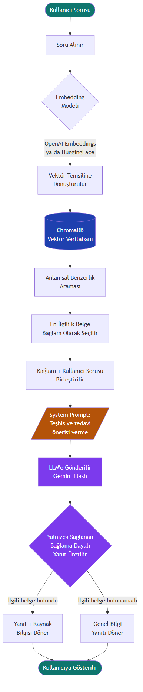

# VetCore — Veteriner İlaç Bilgi ve Karar Destek Sistemi

Veteriner hekimlerin ve hayvan sahiplerinin veteriner ilaçlarını arayabildiği, ilaç bilgilerini inceleyebildiği ve yapay zeka destekli (RAG) bir asistanla soru sorabildiği tam yığın (full-stack) web uygulaması.

> Bitirme projesi olarak geliştirilmiştir.

**Teknolojiler:** FastAPI · SQLAlchemy · MySQL · React 18 · TypeScript · Vite · Tailwind CSS · ChromaDB · Google Gemini

---

## Özellikler

### Rol tabanlı üç panel
| Rol | Yetenekler |
|---|---|
| **Admin** | Dashboard ve istatistikler, ilaç / etken madde / hayvan türü / endikasyon / terapötik grup / kaynak (SPC) yönetimi, Excel'den toplu ilaç aktarımı, eksik veri tespiti, kullanıcı ve rol yönetimi, audit log ve chatbot logları |
| **Veteriner Hekim** | Gelişmiş ilaç arama ve filtreleme (tür, endikasyon, terapötik grup, farmasötik form), detaylı ilaç sayfası, doz hesaplayıcı, favoriler, yapay zeka destekli anamnez analizi, RAG chatbot |
| **Hayvan Sahibi** | Evcil hayvan profilleri, veteriner ziyaret geçmişi, ilaç kayıtları ve ilaç takvimi, basit ilaç arama, chatbot |

### RAG chatbot
İlaç kayıtları ChromaDB'de vektör olarak indekslenir. Kullanıcının sorusuna anlamsal olarak en yakın ilaçlar bağlam olarak Gemini modeline verilir ve yanıtla birlikte kaynaklar gösterilir. Sistem istemi (system prompt) modelin **tanı koymasını, tedavi veya doz önermesini engeller**. Her yanıta güvenlik notu eklenir ve tüm konuşmalar admin panelinde loglanır.



### Güvenlik
- JWT erişim ve yenileme (access/refresh) token'ları, bcrypt ile hashlenmiş şifreler
- Rol tabanlı erişim kontrolü, hem API'de hem de frontend route'larında uygulanır
- Açık kayıtta yalnızca `vet` ve `owner` rolleri seçilebilir. Admin hesabı script ile oluşturulur.

---

## Mimari

```
┌──────────────────────────────┐      /api proxy      ┌──────────────────────────────┐
│  Frontend (React + Vite)     │ ───────────────────▶ │  Backend (FastAPI)           │
│  React Query · Zustand       │                      │  routers → services → models │
│  React Hook Form · Zod       │                      │  JWT auth · RBAC             │
└──────────────────────────────┘                      └───────┬───────────────┬──────┘
                                                              │               │
                                                     ┌────────▼──────┐ ┌──────▼────────┐
                                                     │ MySQL         │ │ ChromaDB      │
                                                     │ (SQLAlchemy)  │ │ ilaç vektörleri│
                                                     └───────────────┘ └──────┬────────┘
                                                                              │
                                                                      ┌───────▼────────┐
                                                                      │ Google Gemini  │
                                                                      └────────────────┘
```

## Proje yapısı

```
├── backend/
│   ├── app/
│   │   ├── core/        # ayarlar, veritabanı bağlantısı, JWT/şifre güvenliği
│   │   ├── models/      # SQLAlchemy modelleri
│   │   ├── schemas/     # Pydantic şemaları
│   │   ├── routers/     # auth, admin, vet, owner, chatbot uç noktaları
│   │   ├── services/    # iş mantığı (arama, import, chatbot, anamnez)
│   │   ├── rag/         # ChromaDB indeksleme
│   │   └── main.py
│   ├── scripts/         # admin oluşturma, veri aktarımı ve Türkçeleştirme scriptleri
│   ├── requirements.txt
│   └── .env.example
├── frontend/
│   └── src/
│       ├── pages/       # admin/, vet/, owner/, auth/
│       ├── components/  # layout'lar, ortak bileşenler
│       ├── services/    # API istemcileri (axios)
│       └── store/       # oturum durumu (zustand)
└── docs/                # diyagramlar
```

---

## Kurulum

### Gereksinimler
- Python 3.11+
- Node.js 18+
- MySQL 8.0+
- Chatbot ve anamnez analizi için [Google AI Studio](https://aistudio.google.com/) API anahtarı

### 1. Veritabanı
```sql
CREATE DATABASE vetcore_db CHARACTER SET utf8mb4 COLLATE utf8mb4_unicode_ci;
```
Tablolar backend ilk kez çalıştığında otomatik olarak oluşturulur.

### 2. Backend
```bash
cd backend
python -m venv venv
venv\Scripts\activate          # macOS/Linux: source venv/bin/activate
pip install -r requirements.txt
copy .env.example .env         # macOS/Linux: cp .env.example .env
```
`.env` dosyasında `DATABASE_URL`, `SECRET_KEY` ve `GEMINI_API_KEY` değerlerini doldurun. Ardından:

```bash
# İlk admin kullanıcısını oluştur
python scripts/create_admin.py admin@ornek.com GucluBirSifre "Ad Soyad"

# (İlaç verisi yüklendikten sonra) chatbot için vektör indeksini oluştur
python -m app.rag.indexer

# Sunucuyu başlat
uvicorn app.main:app --reload --port 8000
```
API dokümantasyonu: http://localhost:8000/docs

Windows'ta `backend/start.ps1` scripti sanal ortamı hazırlar ve sunucuyu başlatır.

### 3. Frontend
```bash
cd frontend
npm install
npm run dev
```
Uygulama: http://localhost:5173. `/api` istekleri Vite proxy'si üzerinden backend'e yönlendirilir.

### İlaç verisi
İlaçlar admin panelindeki **Excel Import** sayfasından toplu olarak yüklenebilir. `backend/scripts/` klasöründe ayrıca VMD veri setinden aktarım (`migrate_from_vmd.py`) ve tür/ilaç adlarını Türkçeleştirme scriptleri bulunur.

---

## Ekip
- **Beyda Şimşek**
- **Atılım Rojda Turan**

## Lisans
© 2026 Beyda Şimşek, Atılım Rojda Turan. **Tüm hakları saklıdır.** Bu depo yalnızca portföy amacıyla incelenmek üzere paylaşılmıştır. Yazılı izin olmadan kodun kopyalanması, değiştirilmesi, dağıtılması veya kullanılması yasaktır. Ayrıntılar için [LICENSE](LICENSE) dosyasına bakın.
